# Ear Olympics

Ear Olympics is an ear-training arcade for the M-VAVE FM-1. A cat called Meow plays you a tune, and you play it
back. It has two games, Copycat (relative pitch, 34 levels) and Simon (follow the lights). Wrong answers play the
right one, and levels rise by themselves as you get things right.

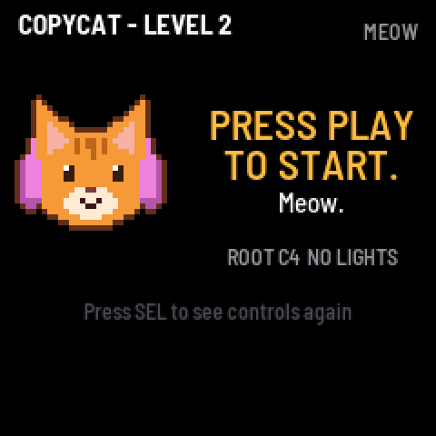

---

## Contents

1. Install
2. Starting up
3. Playing Copycat
4. The controls
5. Levels
6. The cat's moods
7. Simon
8. Saving
9. Troubleshooting

---

## 1. Install

To try it first, open the emulator. It runs the same code in your browser, with sound, and you can play it with a
mouse, a touch screen or your computer keyboard.

To install it from the browser, use Chrome or Edge. Connect the FM-1 by USB, open the installer and press Install.
The browser asks once to allow MIDI, so allow it. Don't unplug the cable while it writes.

To install it from a terminal, run `python3 tools/fm1_install.py earolympics-VERSION.fwsc`.

To go back to the stock firmware, use the installer's last section, which writes M-VAVE's own firmware back.

---

## 2. Starting up

Every start, the cat introduces itself, then explains the controls over three screens. **Any key** goes to the next
screen. **HOME** skips straight to the game.

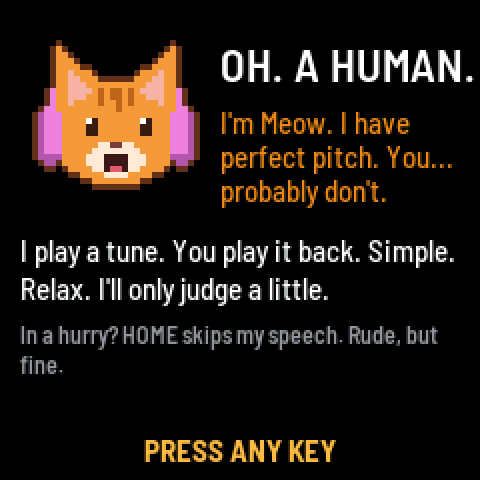

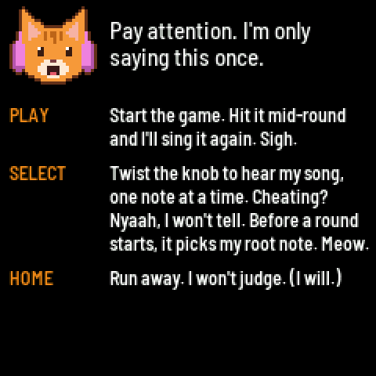

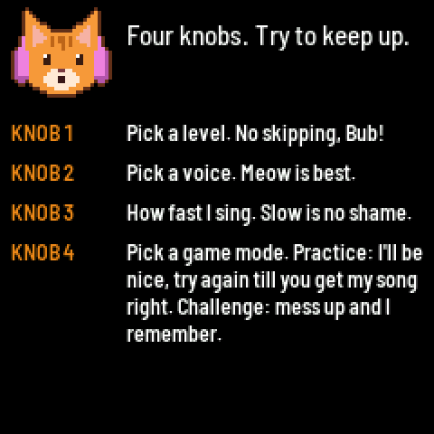

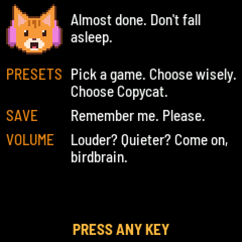

On the ready screen, **PLAY** starts. To see the controls again, press **SEL**. The top line says the game and the
level. Under the cat, a small line shows the root and the lights, and PRACTICE or the speed when they aren't the
default.

---

## 3. Playing Copycat

A round has three parts.

1. **Root.** The cat plays the root note alone, and its key lights. A soft drone keeps it sounding under the melody.
2. **Listen.** The cat dances while the melody plays, once. On the early levels the notes show as dashes, high or low,
   so you can see the shape.
3. **Your turn.** Play the melody back, starting from the first note. The timer doesn't exist: think as long as you
   like.

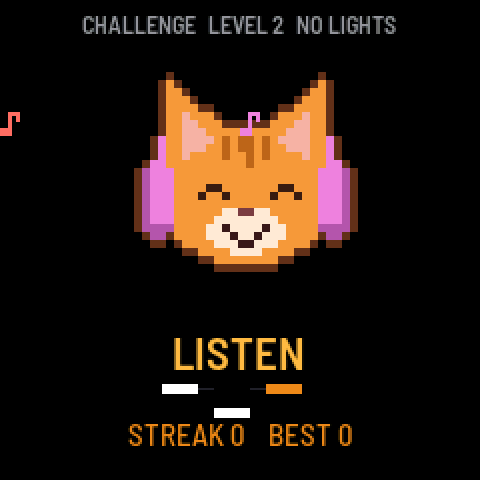

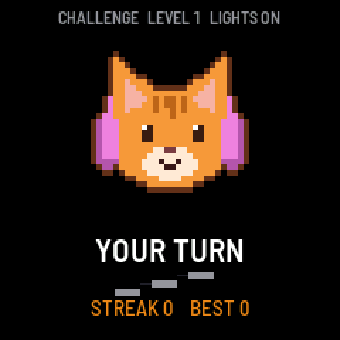

During your turn:

- **PLAY** plays the root and the melody again, from the start.
- Turn the **SELECT knob** to hear the melody one note at a time, forward or back. A note still sounding is cut off
  first, so they never overlap.
- The keys stay at C4 and above, because the FM-1's speaker is small and a low note is weak.

When you get the last note right, the screen says NICE!, WOW!, SWEET!, AMAZING! or YUP, and the cat cheers. When you
get a note wrong, the cat yowls, the screen says MISS, UMM..., WHOOPS., HISSS!, WRONG!, NYAAAHH! or INCORRECT, and then
you hear the right melody over its root. With the lights off, the keyboard slides in with the right notes lit.

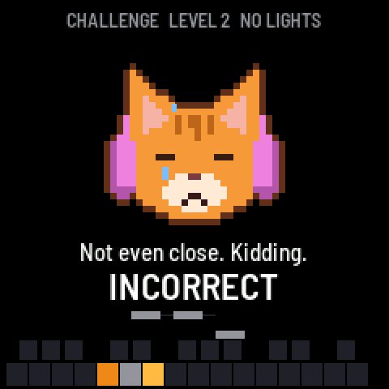

After **three misses in a row**, the cat starts giving advice: press PLAY first, use the SELECT knob, slow it down
with knob 3, try Practice mode, think before you act, sing the notes first.

---

## 4. The controls

| Control | What it does |
| --- | --- |
| Keys | Play the notes back. The FM-1's keys light the root and the level's notes. |
| PLAY | Start. During your turn, play the melody again. On the GOOD JOB card, go on. |
| SEL | On the ready screen, show the controls again. |
| HOME | Stop the game and go back to ready. On the cat's talking screens, skip to the game. |
| SELECT knob | Before a round, choose the root, C4 to G4. During your turn, step through the melody a note at a time. |
| PRESETS knob | Choose the game: Copycat (the default) or Simon. Only while ready. |
| KNOB 1 | Choose the level. Levels are locked, see below. Only while ready. |
| KNOB 2 | Choose the voice of the notes: MEOW (the default), WARM, BELL, E-PIANO, TRIANGLE or SQUARE. Any time. |
| KNOB 3 | Speed: 25% to 200%, in steps of 5%. Any time. |
| KNOB 4 | Mode: CHALLENGE or PRACTICE. Any time. |
| SAVE | Keep your settings, levels and best scores now. |
| VOLUME | The master volume. It shows on the screen for a moment. |

**Challenge** is the game: a miss costs you progress. **Practice** lets you keep trying the same melody until you get
it right, and nothing counts: no streak, no progress, no best. After **three wrong tries** at a no-lights melody, the
cat says "Sssss... let me hit the lights for you." and replays it lit.

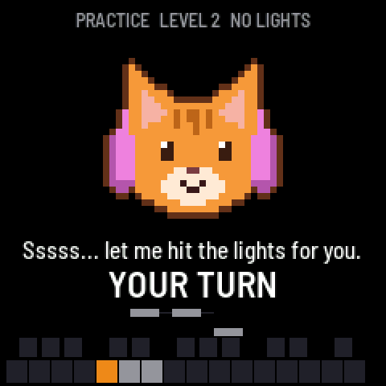

---

## 5. Levels

Copycat has 34 levels. Each adds one new idea: steps (do re mi), then fa and sol, la, ti and the octave, semitones,
leaps, the drone taken away, notes below the root, a root that moves, chromatic notes, and a boss level at 34. When a
new pitch arrives, the lights come back for one level and every melody uses the new pitch. The next level has the same
notes with the lights off.

You move up by playing enough melodies right at a level: 8 at levels 1 to 9, 10 at levels 10 to 20, and 12 after
that. They needn't be in a row, but **a miss takes a quarter of the rounds off your count**, so guessing can't get
you through. Every new level has a card saying what's new.

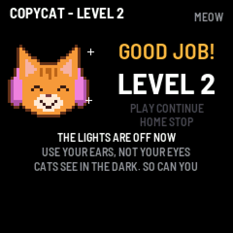

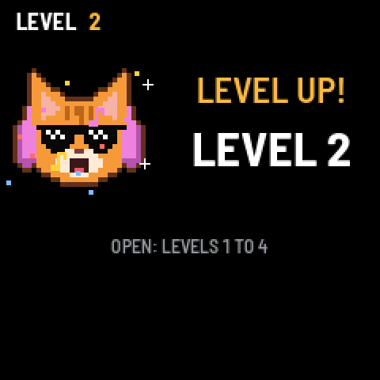

Levels are locked: you can play up to three levels above the highest you've completed. Knob 1 past that tells you
what to finish first.

From level 29 the root changes every round, round the cycle of fifths. Only its key is lit. The screen doesn't name
it, since this is relative pitch.

---

## 6. The cat's moods

Meow dances while the melody plays, sings along while you play, cheers when you're right, droops when you miss, and
celebrates a level up in sunglasses, with a song and a purr. The success sound is always the cat. A miss is the cat's
sad yowl. The MEOW voice hardly bends the pitch, so you have to copy it.

Keep a run going and the cat comments: "Purrfect." every third, "Okay. Impressive." every sixth, and every ninth,
"Are you cheating?"

---

## 7. Simon

Press PRESETS to choose Simon. A sequence plays, lit as it sounds, and you play it back. Each round adds one note, and
a wrong note ends the game. Your score is the longest sequence you got right. There's no root, because there's
nothing to establish, and it speeds up as the sequence grows.

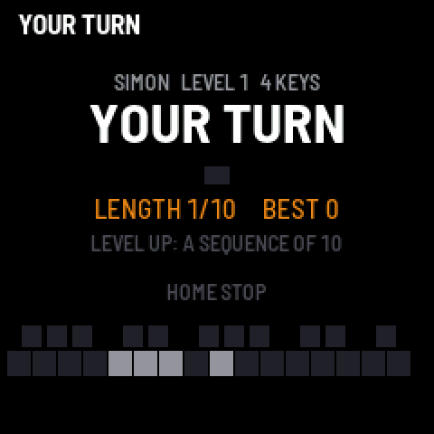

The levels set how many keys are in play: 4, 5, 8 (the major scale) and 13 (every key of the octave). A sequence of ten
moves you up a level.

---

## 8. Saving

SAVE keeps the game, the root, your levels and best scores. HOME keeps them too, and so does a streak ending, a game
ending, or moving up a level. Nothing is written to the FM-1's flash between rounds.

---

## 9. Troubleshooting

| Problem | What to do |
| --- | --- |
| The installer can't find the FM-1 | Use a USB data cable straight into the computer, and close other MIDI apps and browser tabs that use MIDI. If it still isn't found, switch the FM-1 off, hold OCT- while you switch it on (it then waits for an update), and install again. |
| The notes are hard to hear | Turn the volume up, or change the voice with knob 2. The FM-1's speaker is small, so headphones help. |
| A level is locked | Finish more levels first. You can play up to three above the highest you've completed. |
| It's too hard | Turn knob 3 to slow the melody down, or knob 4 to Practice. There's no shame in either. |
