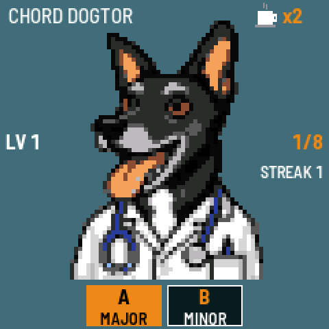
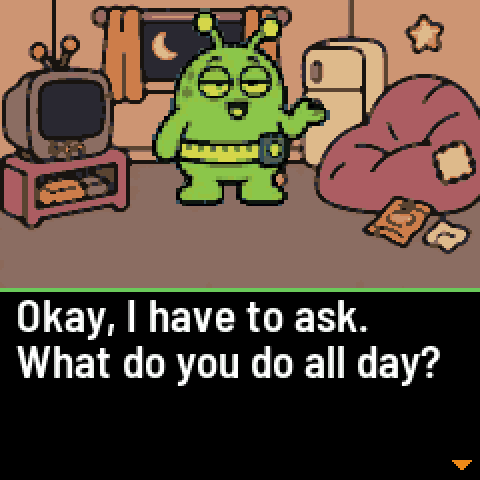
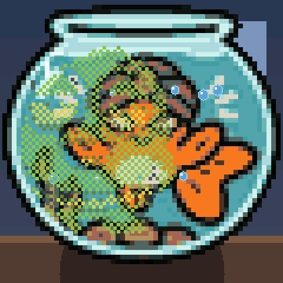
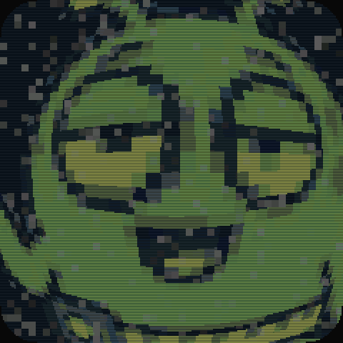
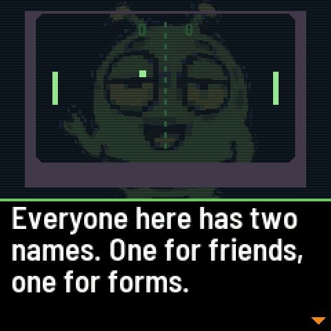

# Ear Olympics

*"It was THESE. Obviously."* Meow, a cat, after you got it wrong.

A cozy ear-training arcade for the M-VAVE FM-1, hosted by a cast of animals and objects who are brilliant at music and
hopeless at everything else. A cat with perfect pitch who is not shy about it. A dog in a white coat who feels every
wrong chord in her bones. An alien who came for the snacks. A goldfish who sees the future and forgot what it was.

You come to learn to hear. You stay because the alien is about to show you something on the TV and he says, "Don't say
anything. Just watch."

Every question is relative to a root note that sounds first, so you learn how notes sit against each other, not what
they are called. Each game climbs one new trick at a time, the levels rise on their own, and a wrong answer never
stings: you hear the right one, the key lights, and someone makes a face. Nobody shouts at you. The cat comes close.

## Copycat, with Meow

Meow is an orange tabby in headphones with perfect pitch, and mentions it. You hear a root note and a short melody over
it, then play the melody back by ear. It climbs 34 levels: steps, thirds, leaps, the whole scale, semitones, a root
that moves. When a new pitch arrives the lights come back for a level, then go out. The cat dances, sings along,
droops when you miss, and wears sunglasses when you level up.

## Chord Dogtor, with Dr. Diggie

Dr. Diggie is a very serious dog in a white coat who feels every wrong chord personally. He plays a chord over a quiet
machine hum and a heart-monitor beep, and you press the key that names it: major, minor, then diminished, augmented,
sevenths and suspended. He speaks in silent-film title cards. A right answer earns a soft bell and a happy howl.

## Name That Interval, with Van

Van is an alien surveyor who is only here for the snacks. His game is about 90% hanging out on his couch and 10% ear
training: which note is higher, then which interval it was. Now and then he stops and shows you something: a long look
at Simoné the goldfish, the fridge hum, the TV static, and 10-ISH, a game of Pong on his TV that you play with knob 4
while he keeps talking.

## Simoné Says, with Simoné

Simoné is a goldfish clairvoyant with a three-second memory, which makes her an excellent teacher of the one thing she
cannot do. She plays a growing sequence on four keys and you play it back. Each note has a word (DRIP, WATER, SPLASH,
SPLISH) that floats above her bowl as a bubble, and the bubbles pop while you think. She rhymes, she calls you darling,
and she knows, a little, that she lives in a box.

## Coming soon

Eight more characters are on the way: a raccoon in a trench coat, a hedgehog inspector, a crab with a metal detector, a
bear who apologizes to the tuna, a yodeling goat, a snail in a racing helmet and others. A few of them are already
suspicious of each other.

## Try it

This is version {{VERSION}}. Installing on a real FM-1 isn't open yet, so for now you can play it in your browser.

- [Try it in the browser](emu/). Play it right here, with sound. It runs the same code as the FM-1, so you don't
  need one. A MIDI keyboard works too.
- The [Manual](manual/) explains the screen, the controls, the levels and the cat's moods.
- The [Source](https://github.com/asilagy/ear-olympics) is under MPL-2.0. It's built on fm1-base and
  felucca-bsp, which come from Felucca by Leo Kuroshita, Hügelton Instruments.

M-VAVE and FM-1 are trademarks of their owners. Ear Olympics is not affiliated with M-VAVE.
