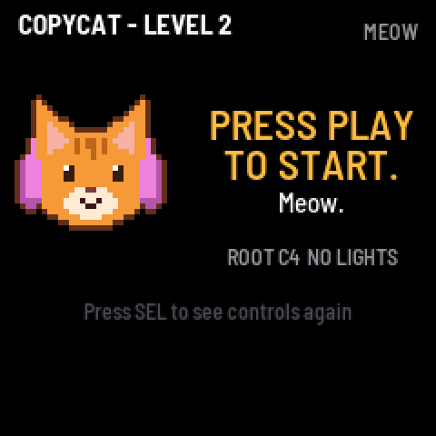
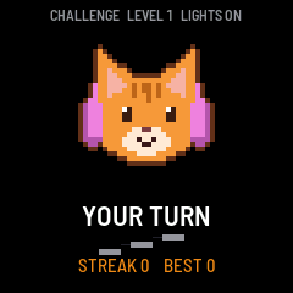
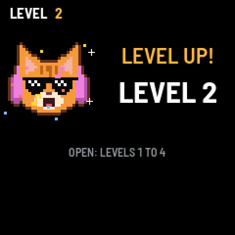

# Ear Olympics

Ear Olympics turns the M-VAVE FM-1 into an ear-training arcade, run by a cat called Meow who has perfect pitch and
is not shy about it. In **Copycat**, you hear a root note and a short melody over it, then play the melody back by ear.
Levels rise as you get things right, and every mistake plays the right answer, so you learn from it.

Everything is relative to a root note that sounds first, so Copycat trains relative pitch, never perfect pitch. It
climbs 34 levels, one new idea at a time: steps, thirds, leaps, the whole scale, semitones, a moving root. When a new
pitch arrives the lights come back for a level to introduce it, then go out again.

This is version {{VERSION}}. You install it at your own risk, and the installer can put M-VAVE's own firmware back.

- [Try it in the browser](emu/). Play it right here, with sound. It runs the same code as the FM-1, so you don't
  need one.
- [Install](install/) it from Chrome or Edge, with the FM-1 connected by USB.
- The [Manual](manual/) explains the screen, the controls, the levels and the cat's moods.
- [Download {{PKG}}](firmware/{{PKG}}) to use the command-line installer: `python3 tools/fm1_install.py {{PKG}}`.
- The [Source](https://github.com/asilagy/ear-olympics) is under MPL-2.0. It's built on fm1-base and
  felucca-bsp, which come from Felucca by Leo Kuroshita, Hügelton Instruments.

M-VAVE and FM-1 are trademarks of their owners. Ear Olympics is not affiliated with M-VAVE.
